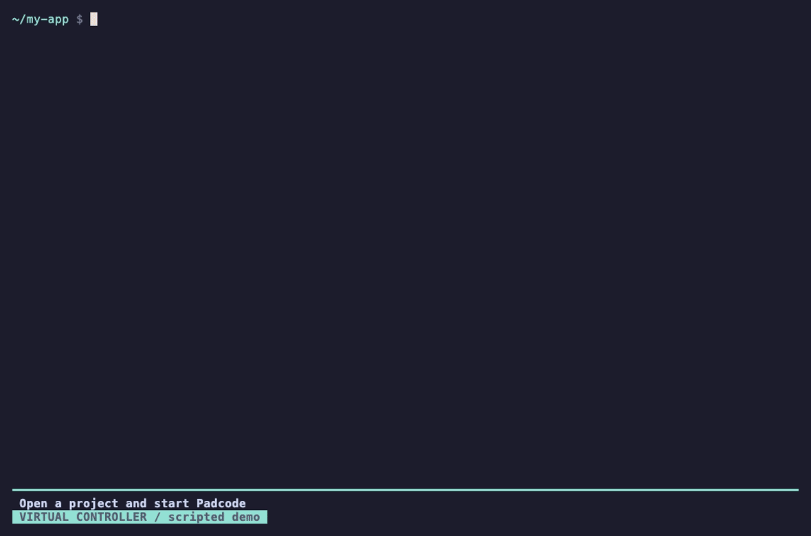

# Padcode

Control your own AI coding agent with a gamepad.

Padcode is a local command-line tool for macOS. You keep your terminal, your project, your Agent (Claude Code, Codex or any interactive CLI) and your accounts; Padcode adds controller input, key mapping, a controls pane and optional local voice dictation.

<p align="center"></p>

<p align="center"><sub>Scripted recording of real Padcode screens. The controller input is virtual and the Agent, microphone and transcriber are stand-ins. See <a href="docs/demo.md">how the demo is made</a>; run it yourself with <code>npm run demo</code>.</sub></p>

**Status: release candidate `0.1.0-rc.10`, macOS only, not yet published to npm.** The full flow works end to end with a user-provided Agent: Bluetooth setup, controller-operated menus, launching the Agent with automatic controller handoff, a tmux controls pane with an Options menu, quick commands and opt-in voice dictation that types into the Agent's input. Automated tests cover every stage; hardware acceptance rests on the maintainer's reports in [`docs/stages`](docs/stages). See the [compatibility matrix](docs/distribution.md#compatibility) for what has been tested on real hardware.

Controllers: DualShock 4 is tested; PlayStation DualSense, Xbox, Nintendo Switch Pro and other SDL gamepads are detected automatically and shown with their own button names, but are not yet tested on hardware.

## What you can do with a controller

| Where | Controls |
| --- | --- |
| Player Hub and setup | D-pad moves, X confirms, O goes back. Every screen returns to the Hub. |
| Agent session | D-pad arrows, X Enter, O Escape, L1 Tab, R1 Shift+Tab. Left stick moves the cursor, right stick jumps by word and to line start/end, Square backspace, Triangle delete word, L3 delete. R2 newline and R3 undo in Claude Code; R2 newline and R3 transcript in Codex (assumes each Agent's default keymap). Keyboard always works too. |
| Options (with tmux) | Controls menu: resume, pause, browse history, send interrupt (Esc), clear input, quick commands, controller map, voice undo/review, end session. |
| Share / View | Quick commands: types `/` or `@` to open the Agent's own pickers, or a common slash command (`/clear`, `/compact`, `/model`, `/resume`, ...) for Claude Code and Codex. Nothing is sent; X runs it. Without tmux, Share types `/`. |
| Touchpad click | Types `@` to open the Agent's file picker; hold L2 to dictate the file name. |
| L2 (macOS, opt-in) | Hold to dictate, release to transcribe. The text is typed into the Agent's input and **never sent**; X sends it. Options > Undo voice insert removes it. |

Voice transcription runs on your Mac: macOS on-device speech needs nothing installed; whisper.cpp (`brew install whisper-cpp`) is more accurate, and Padcode can download a pinned, checksum-verified model after you confirm; any command that prints text also works. Padcode never sends audio anywhere.

## Install

Requirements: macOS 13 or later (Apple silicon or Intel), Node.js 22.14 or later, a gamepad, and the Agent you want to drive. [tmux](https://github.com/tmux/tmux) 3.2 or later (`brew install tmux`) is recommended for the controls pane; without it Padcode runs in plain mode.

Once published, install the current release candidate with:

```sh
npm install -g padcode-cli@next
```

The npm package is `padcode-cli` (npm reserves `padcode` as too close to an existing package); the command it installs is `padcode`. `npm install -g padcode-cli` installs the latest stable version once `0.1.0` is out. The `padcode-darwin` platform package (prebuilt, universal helpers) is installed automatically. No Xcode, CMake or compiler is needed and no install scripts run.

Then open a project and start:

```sh
cd my-project
padcode
```

First launch walks you through pairing the controller, choosing your Agent and an optional microphone. Later launches open the Player Hub; **Start agent session** shows the exact command and directory before anything runs. See the [terminal setup guide](docs/setup.md) for every screen.

### Upgrade

```sh
npm install -g padcode-cli@next     # release candidates
npm install -g padcode-cli@latest   # stable releases
```

Helpers are reused byte for byte when native code has not changed, so macOS keeps Bluetooth, microphone and speech permissions across those upgrades.

### Uninstall

```sh
npm uninstall -g padcode-cli
```

Configuration (`~/.config/padcode`) and downloaded whisper models (`~/.local/share/padcode`) are kept; delete them to remove everything. See [data handling](docs/distribution.md#data-handling).

## Troubleshooting

| Problem | What to try |
| --- | --- |
| "Prebuilt Padcode helpers are only packaged for macOS so far" | Linux and Windows are not supported yet; you can [build from source](#build-from-source). |
| "macOS helpers (padcode-darwin) are not installed" or "does not match Padcode" | Reinstall with `npm install -g padcode-cli@next` without `--omit=optional`, so both packages have the same version. |
| Controller not found during setup | Put it in pairing mode (DualShock 4: hold SHARE + PS until the light bar flashes quickly) and scan again, or connect it with a USB cable. Allow **padcode-bluetooth** in System Settings > Privacy & Security > Bluetooth. |
| Buttons do nothing in the Agent | Check the status pane: if it shows PAUSED, press Options (plain mode) or choose Resume in the Options menu. After closing a menu, release all buttons; input resumes after 250 ms. `padcode controllers` shows live input. |
| No controls pane | Install tmux 3.2 or later. The launch confirmation says which display mode is used and why. |
| Box characters look misaligned | Run with `PADCODE_ASCII=1`, or set your terminal to draw ambiguous-width characters single width. |
| macOS asks for microphone access again after an update | Builds are not Developer ID signed yet; allow **Padcode Audio** once more when a release changes the native helpers. |
| Voice: "no on-device speech model" | Choose another language or switch to whisper.cpp in Player Hub > Voice + microphone. |
| Leave a stuck session | Ctrl+] always ends the session and restores the terminal. |

For routing diagnostics run `PADCODE_INPUT_TRACE=1 padcode run`; it prints metadata only, never typed text. Still stuck? [Open an issue](https://github.com/thinxpro/padcode/issues/new/choose) with `padcode --version`, your macOS version, controller and Agent.

## Product boundaries

- Install and launch through a CLI; no standalone desktop app or DMG.
- Bring and authenticate your own AI coding agent; select an installed command or provide a custom command.
- Preserve the selected agent's terminal interface, with keyboard and controller input available together.
- No model service, account system, prompt proxy, cloud execution or hosted code service.
- Keep configuration and tool records local. The selected agent determines its own networking, model billing and data handling.
- Voice input is optional and local (macOS). Desktop control is a possible future extension.

## Build from source

Development prerequisites: Node.js 22.14+ (Node 22 LTS recommended), npm, CMake 3.24+ and a C/C++ compiler; use Xcode/Command Line Tools on macOS. The full test suite also needs Python 3 and `pgrep`. These are developer requirements only: installed packages are prebuilt and need just Node.js and npm.

```sh
npm ci --ignore-scripts
npm run check
node dist/cli.js demo
node dist/cli.js
npm run demo          # scripted README demo (needs tmux)
```

The first native build downloads checksum-pinned SDL source from its official GitHub release and requires network access. `demo` is explicitly simulated; `controllers` shows real device state. Q / Esc exits the dashboard; Ctrl+C interrupts. `controllers --json` emits pipe-friendly events. The interface supports narrow terminals, `NO_COLOR` and `TERM=dumb`, and waits for a connection when no controller is present. `PADCODE_ASCII=1` switches frames and the logo to ASCII (for terminals set to draw ambiguous-width symbols double wide); `PADCODE_NO_ANIM=1` skips the welcome sweep.

Bluetooth discovery keeps known paired/connected controllers visible, even when no nearby device is discovered.

A uniquely identity-matched saved controller can operate menus directly: D-pad up/down, X to confirm and O to go back/cancel. During initial setup or when identity is ambiguous, D-pad navigates and claims control, or X claims without confirming. Keyboard input remains available, and custom command text still uses the keyboard.

Interactive startup without arguments opens setup, or the Player Hub if configuration exists. `padcode config` reconfigures, and Player Hub > Voice + microphone changes only voice. Configuration lives at `$XDG_CONFIG_HOME/padcode/config.json` when that variable is an absolute path, otherwise `~/.config/padcode/config.json`. Saving configuration never launches an Agent; Start agent session (or `padcode run`) shows the executable, literal arguments and project directory before you confirm. With tmux 3.2+ installed the session runs in a private tmux server with a status pane; Padcode never installs tmux, and `PADCODE_PANEL=off` keeps the plain transparent mode (Options then pauses/resumes). Ctrl+] always ends the session. `PADCODE_INPUT_TRACE=1` prints metadata-only routing diagnostics. Padcode does not collect credentials or record session content.

See the [terminal setup guide](docs/setup.md) for the complete flow and macOS permission boundaries, and the [Bluetooth acceptance report](docs/stages/p0-config-validation.md) for physical test status.

### Local npm packages

Padcode ships as two npm packages: `padcode-cli` (JavaScript only, provides the `padcode` command) and `padcode-darwin` (prebuilt helpers and the PTY runtime, universal for Apple silicon and Intel, macOS 13 or later). Installing them needs Node.js 22.14+ and npm, not Xcode, CMake or a compiler, and runs no install scripts. After `npm run check`, build both packages locally; no npm account is needed and nothing is published. Local packages stay `private` so they cannot be published by accident; only the [release workflow](docs/distribution.md#release-procedure) packages with `--release`:

```sh
npm run package
npm install -g ./artifacts/padcode-darwin-0.1.0-rc.10.tgz ./artifacts/padcode-cli-0.1.0-rc.10.tgz
padcode
```

Helpers are ad-hoc signed by default. Set `PADCODE_SIGN_IDENTITY` to a codesign identity (for example an Apple Development or Developer ID Application certificate) to sign them with hardened runtime and their microphone/Bluetooth entitlements; `PADCODE_SIGN_TIMESTAMP=off` skips the secure timestamp for offline development signing. With a stable identity, macOS keeps microphone permission across rebuilds. Without one, packaging reuses the previous release's helpers byte for byte (the newest `padcode-darwin` on any npm dist-tag, or `--reuse <tarball>`; `--fresh` to skip) when nothing under `native/` changed and the signer is the same, so users are asked for microphone, speech or Bluetooth permission again only after releases that change the native helpers. The [prebuilt packages stage](docs/stages/prebuilt-packages.md) records the checks. Other operating systems are not packaged yet.

## Design documents

| Document | Contents |
| --- | --- |
| [Product](docs/product.md) | User flow, scope and interaction constraints |
| [Architecture](docs/architecture.md) | CLI, SDL3, PTY, input routing and process lifecycle |
| [Agent integration](docs/agent-integration.md) | Generic mode, key profiles and optional structured adapters |
| [Distribution](docs/distribution.md) | npm, native artifacts, Homebrew/curl and public release preparation |
| [Roadmap and acceptance](docs/roadmap.md) | Stages, validation methods and completion criteria |
| [Decisions](docs/decisions.md) | Confirmed and provisional decisions |
| [Demo recording](docs/demo.md) | How the README demo is made and how to record real footage |
| [Contributing](CONTRIBUTING.md) | Development scope, PRs and test evidence |

## Contributing

Bug reports, controller and terminal compatibility reports, and pull requests are welcome. Read [CONTRIBUTING.md](CONTRIBUTING.md) and the [development rules](AGENTS.md) first; this project follows the [Code of Conduct](CODE_OF_CONDUCT.md). Report security issues privately as described in [SECURITY.md](SECURITY.md). Changes are listed in the [changelog](CHANGELOG.md).

## License

Padcode is released under the [MIT License](LICENSE): you may use, copy, modify and redistribute it, including commercially, as long as the copyright and license notice are kept. Third-party components keep their own licenses; see [third-party notices](THIRD_PARTY_NOTICES.md).
