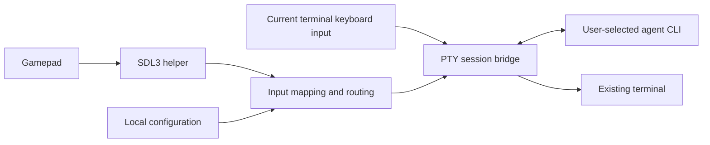

# Architecture

This page describes the target architecture. The TypeScript CLI, SDL3 helper, JSONL protocol, diagnostic dashboard and Bluetooth-first onboarding are implemented. Keyboard PTY bridging is implemented; gamepad-to-agent mapping remains future work. Onboarding uses a separate macOS IOBluetooth helper for discovery, pairing and connection; SDL verifies input independently. See the [onboarding stage](stages/p0-config-bluetooth.md).

## System structure

## Proposed components

| Component | Approach | Validation focus |
| --- | --- | --- |
| CLI/configuration | Node.js LTS + TypeScript | Node version range, interactive setup and packaging |
| Native controller input | SDL3 + small C/C++ helper | Physical macOS input, background events and reconnection |
| Process communication | stdio JSONL | Protocol versions, event rates and failure handling |
| Terminal bridge | Evaluate node-pty first | TUI compatibility, prebuilt native dependencies and lifecycle |
| Configuration | Local JSON | Schema validation, migrations and user overrides |
| Distribution | npm package + platform artifacts | Clean installation without build tools |

No Electron, React, xterm.js, HTTP backend, database or cloud server is needed. The PTY forwards data between the existing terminal and child process; the terminal handles rendering.

P0-2 pins node-pty 1.1.0 and bundles its Unix runtime and current-platform native binary in the local npm artifact. macOS uses the upstream prebuild; Linux builds during development/CI. Installation runs no scripts and requires no compiler. The pinned Unix fd accessor supplies bounded asynchronous writes; a documented exit-timer patch preserves paused final output. See the [stage plan](stages/p0-2-pty-session.md). Universal distribution remains a later gate.

## Process responsibilities

- CLI: read configuration, run setup, manage children, switch input modes and restore the terminal.
- SDL3 helper: enumerate devices, emit normalized input events and report disconnections/errors. Reserve stdout for the protocol and stderr for diagnostics.
- Agent child: run the selected executable and arguments through a PTY with an explicit project directory and required environment.
- Optional adapters: provide extra capabilities without becoming a dependency of generic mode.

Pass executable paths and arguments separately; do not concatenate user input into shell commands. Basic agent launch does not require zsh; only run a shell when explicitly selected. The agent may inherit the user's runtime environment, but environment values must not appear in diagnostic logs.

## Input and terminal lifecycle

1. Finish setup, enter session state, then enable stdin raw mode.
2. Forward keyboard bytes, PTY output and window resizing, preserving colors, Unicode and interactive TUIs.
3. Map controller input to terminal bytes; handle tool-specific chords in the routing layer.
4. Restore terminal mode, cursor and listeners when the child exits.
5. Define cleanup for SIGINT, SIGTERM, helper crashes and exceptional exits. Do not assume Ctrl+C in raw mode becomes a parent-process signal.
6. Clean up owned process groups when the parent exits to avoid orphaned agents or helpers. Document terminal recovery for uncatchable termination.

Do not infer agent completion from terminal titles, output text or spinner characters. Terminal output is not a trusted control protocol for Padcode.

## Events and state

Helper events include protocol version, device instance ID, sequence number, monotonic timestamp, event type and button/axis values. Exchange capabilities at startup.

Use button edges. Intermediate analog values may be coalesced, but release and disconnect events must not be lost. Bound queues so input floods do not block the terminal. Reset state on disconnect and never replay stale actions on reconnection.

Global states include setup, active session, paused mapping, controller disconnected and exit cleanup. PTY key bytes in the first release do not represent an OS-level held key.

## Storage and logs

Follow platform conventions for user-level configuration. Initially accept only explicitly configured user settings; do not automatically execute commands from project configuration. Logs contain connection events, error codes, versions and lifecycle information. Full input/output tracing requires explicit opt-in and a notice that it may contain project content.

## References

- [SDL3 Gamepad API](https://wiki.libsdl.org/SDL3/CategoryGamepad): devices, optional capabilities and background events.
- [node-pty](https://github.com/microsoft/node-pty): PTY features, platforms and build requirements; pin a release during P0 validation.
- [Codex app-server](https://learn.chatgpt.com/docs/app-server): a future structured integration candidate, not a base dependency.
