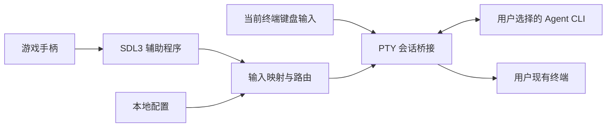

# 技术架构

本页描述整体目标架构。已实现 TypeScript CLI、SDL3 helper、JSONL 协议、诊断界面及蓝牙优先配置向导；PTY/Agent 桥接仍待后续阶段实现。配置向导另有 macOS IOBluetooth helper，负责系统设备扫描/配对/连接，SDL 独立验证输入。见 [配置阶段](stages/p0-config-bluetooth.md)。

## 系统结构

## 推荐选型

| 模块 | 方案 | 验证重点 |
| --- | --- | --- |
| CLI/配置 | Node.js LTS + TypeScript | Node 版本范围、交互式向导与打包 |
| 原生手柄输入 | SDL3 + 小型 C/C++ 辅助程序 | macOS 真机输入、后台事件、热插拔 |
| 进程通信 | stdio JSONL | 协议版本、事件频率、故障处理 |
| 终端桥接 | 首先验证 node-pty | TUI 兼容、原生依赖预编译、生命周期 |
| 配置 | 本地 JSON | schema 校验、迁移、用户覆盖 |
| 发布 | npm 主包 + 平台产物 | 无编译工具的干净环境安装 |

不需要 Electron、React、xterm.js、HTTP 后端、数据库或云服务器。PTY 在已有终端与子进程之间转发数据，现有终端承担渲染。

node-pty 的原生依赖能否满足安装要求是 P0 阻塞项。如必须现场编译，需提供匹配 Node ABI 的预编译产物，或改用独立 PTY 辅助程序；完成验证后记录最终决策。

## 进程职责

- CLI 主进程：读取配置、运行向导、管理子进程、切换输入模式、恢复终端。
- SDL3 辅助进程：枚举设备、产生规范化输入事件、报告断线与异常。stdout 专用于协议，诊断写 stderr。
- Agent 子进程：继承明确的项目工作目录和必要环境，通过 PTY 执行用户选择的程序与参数。
- 可选适配器：提供额外能力，首版通用链路不依赖它。

程序路径与参数以数组传递，不把用户输入拼接成 shell 命令。基础 Agent 启动不要求经过 zsh；用户主动选择 shell 时再运行它。Agent 环境可以继承用户运行环境，但不得把环境值写入诊断日志。

## 输入与终端生命周期

1. 向导结束后进入会话态，再开启 stdin raw mode。
2. 转发键盘字节、PTY 输出和窗口 resize；保留颜色、Unicode 与交互式 TUI。
3. 手柄输入经配置映射产生终端字节，工具专用组合键在路由层处理。
4. 子进程结束时恢复原有终端模式、光标和监听器。
5. 对 SIGINT、SIGTERM、辅助进程崩溃和异常退出设置明确清理路径；不能假定 raw mode 下 Ctrl+C 一定成为父进程信号。
6. 父进程退出需处理所属子进程组，避免遗留 Agent 或 helper。强制杀死等无法捕获的情况应给出恢复终端的诊断指引。

不要通过修改终端标题、扫描输出文字或观察旋转字符来断言 Agent 已完成。不要把终端输出中的提示当作工具自身的可信控制协议。

## 输入事件与状态

辅助程序事件包含：协议版本、设备实例 ID、序号、单调时间戳、事件类型、按钮/轴值。启动时交换能力信息。

按钮使用边沿事件；模拟轴可合并中间值，但不得丢弃释放与断线事件。设置队列上限，避免输入洪泛阻塞终端。连接丢失后复位状态，恢复时不补发旧操作。

全局状态至少包括配置、会话运行、映射暂停、控制器断开、退出清理。首版 PTY 按键不代表操作系统级“持续按下”。

## 存储与日志

用户级配置位置按平台约定确定。首版只接受用户主动设置的配置，不自动执行项目内配置中的任意命令。日志仅记录连接、错误码、版本和生命周期；完整输入输出追踪必须显式开启，并告知可能包含项目内容。

## 参考资料

- [SDL3 Gamepad API](https://wiki.libsdl.org/SDL3/CategoryGamepad)：设备、可选能力及后台事件。
- [node-pty](https://github.com/microsoft/node-pty)：PTY 能力、平台与构建要求；具体发布版本在 P0 锁定。
- [Codex app-server](https://learn.chatgpt.com/docs/app-server)：后续结构化适配候选，不属于首版基础依赖。
